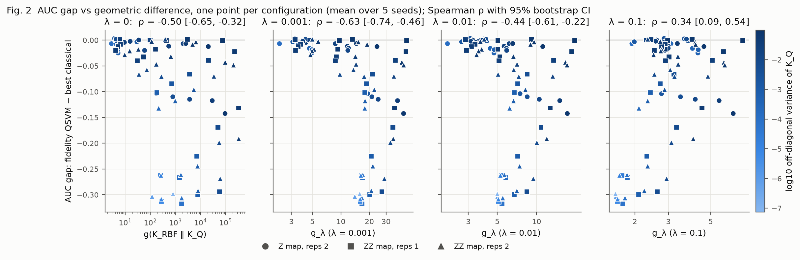

# qkernel-hep: does the geometric difference predict when a quantum kernel helps?

[](https://github.com/Devkeerthi-code/qkernel-hep/actions/workflows/tests.yml)
[](LICENSE)

We compare fidelity and projected quantum kernels with tuned classical models on 818,238 simulated ATLAS
H→ττ events from the Higgs Boson Machine Learning Challenge 2014:

- **Quantum kernels:** Z and ZZ feature maps, 2–14 qubits, five bandwidths.
- **Classical models:** logistic regression, RBF-SVM and XGBoost.
- **Design:** 500 training and 1,000 test events, 5 seeds, 79 configurations in all.

We test four hypotheses written before the experiments ([docs/hypotheses.md](docs/hypotheses.md)).

**Headline result:**
- **Tuned classical baselines match or beat every quantum kernel.** In 0 of 79 configurations does either quantum
  kernel beat the best classical model by more than the seed spread.
- **The geometric difference g of Huang et al. (2021) does not predict the gap.** It has the wrong sign: Spearman
  ρ = −0.44 [−0.61, −0.22] for the regularised g (λ = 0.01).
- **This does not contradict Huang et al.** Their necessary condition for an advantage is g ≳ √N, and the
  regularised g never exceeds √N = 22.4 (maximum 19.6). What fails is using g as a graded pre-screen.
- **Kernel concentration explains the results better.**

No quantum advantage is claimed. The full write-up is the 8-page report, **[report/main.pdf](report/main.pdf)**.



*Figure 2. Quantum-minus-classical AUC gap against g for four regularisations λ, one point per configuration,
coloured by kernel variance (log10). The gap is never significantly positive, and larger g goes with a more
negative gap.*

## Reproduce Figure 1 in under 10 minutes

You need no dataset and no quantum software. The figures are rebuilt from the results committed in
[`results/`](results/). Python 3.12 is required (the version tested in CI).

Linux / macOS:

```bash
git clone https://github.com/Devkeerthi-code/qkernel-hep.git
cd qkernel-hep
python3.12 -m venv .venv
.venv/bin/python -m pip install -r requirements-figures.txt
.venv/bin/python scripts/make_figures.py --fig 1
```

Windows (PowerShell):

```powershell
git clone https://github.com/Devkeerthi-code/qkernel-hep.git
cd qkernel-hep
py -3.12 -m venv .venv
.venv\Scripts\python -m pip install -r requirements-figures.txt
.venv\Scripts\python scripts\make_figures.py --fig 1
```

The output is `results/figures/fig1_auc_vs_qubits.{png,pdf}`. Measured on a laptop from a fresh clone with a cold
pip cache: clone 4 s, install 2 min 10 s, first figure run 59 s (it builds matplotlib's font cache; later runs take
about 11 s). That is about 3.5 minutes in total. The regenerated PNG and PDF were byte-identical to the committed
ones.

## Full install, tests and data

```bash
.venv/bin/python -m pip install -r requirements.txt   # pinned: numpy, scikit-learn, xgboost, qiskit, ...
.venv/bin/python -m pytest -q                         # 96 tests on synthetic data, a few minutes
.venv/bin/python scripts/download_data.py             # ATLAS data -> data/, then verified
```

`download_data.py` fetches `atlas-higgs-challenge-2014-v2.csv.gz` from
[CERN Open Data record 328](https://opendata.cern.ch/record/328)
([doi:10.7483/OPENDATA.ATLAS.ZBP2.M5T8](https://doi.org/10.7483/OPENDATA.ATLAS.ZBP2.M5T8)), 65.6 MB, and checks
its size and Adler-32 checksum (`e4717bbe`). It took 2 minutes here. The data are needed only for Figure 5 and for
rerunning the experiments. They are not in git (`data/` is ignored).

## One command per figure

Each command rebuilds one figure from `results/` in about 10–15 s. It does not rewrite the analysis files.

| Figure | Shows | Command | Needs data |
|---|---|---|---|
| 1 | AUC vs qubits for every model (H1) | `python scripts/make_figures.py --fig 1` | no |
| 2 | AUC gap vs geometric difference, four λ (H2) | `python scripts/make_figures.py --fig 2` | no |
| 3 | Kernel variance and AUC vs qubits, per bandwidth (H3) | `python scripts/make_figures.py --fig 3` | no |
| 4 | g, variance and AUC vs bandwidth at fixed qubits (H4) | `python scripts/make_figures.py --fig 4` | no |
| 5 | Healthy vs concentrated kernel matrices | `python scripts/make_figures.py --fig 5` | **yes** |
| 6 | Shot noise, depolarising noise and the IBM hardware runs | `python scripts/make_figures.py --fig 6` | no |
| 7 | Robustness: PCA vs boosted-tree feature selection | `python scripts/make_figures.py --fig 7` | no |
| 8 | H2 under the alternative feature reduction | `python scripts/make_figures.py --fig 8` | no |

`python scripts/make_figures.py` with no option rebuilds all eight figures. It also recomputes every hypothesis test
into `results/summary_table.csv` and `results/h2_analysis.json`. It takes about 4 minutes, and the output is
deterministic: a rerun leaves `results/` byte-identical.
`notebooks/02_analysis.ipynb` runs the same code and shows the tables.

## Rerunning the experiments

Every experiment is one config and one command. Runs are resumable: existing rows in `runs.jsonl` are skipped.
Times were measured on an 8-thread laptop (Intel Core Ultra 7 256V).

| Experiment | Command | Output | Time |
|---|---|---|---|
| Main grid: 2–10 qubits × 3 feature maps × 5 bandwidths × 5 seeds | `python -m src.run configs/main_grid.yaml` | `results/main_grid/` | 1 h 43 min |
| Training-size sweep | `python -m src.run configs/n_sweep.yaml` | `results/n_sweep/` | 1 h 08 min |
| 12 and 14 qubits | `python -m src.run configs/big_qubits.yaml` | `results/big_qubits/` | 17 min |
| Boosted-tree feature selection (robustness) | `python -m src.run configs/fs_gbdt.yaml` | `results/fs_gbdt/` | 39 min |
| Shot and depolarising noise | `python scripts/noise_study.py` | `results/noise.csv` | not timed |
| IBM hardware, free noisy simulator | `python scripts/ibm_hardware_run.py --mode fake` | `results/hardware/` | not timed |
| Report numbers, then the PDF | `python scripts/report_numbers.py`, then in `report/`: `pdflatex main`, `bibtex main`, `pdflatex main` twice | `report/main.pdf` | < 1 min |
| Check every number in the PDF | `python scripts/check_report_numbers.py` | `report/number_check.md` | < 1 min |

`bash scripts/run_queue.sh configs/main_grid.yaml configs/n_sweep.yaml configs/big_qubits.yaml` runs several
configs in a row with logging and retries. A real-hardware run (`--mode real`) uses your own IBM Quantum account and
QPU minutes; see [docs/IBM_HARDWARE.md](docs/IBM_HARDWARE.md).

## Repository layout

```
qkernel-hep/
├── src/                    library
│   ├── kernels.py          NumPy statevector Z/ZZ feature maps, fidelity / projected / RBF kernels, shot noise
│   ├── data.py             ATLAS loading, features, seeded balanced splits, PCA or boosted-tree selection
│   ├── classical.py        logistic regression, RBF-SVM, XGBoost, precomputed-kernel SVM (all CV-tuned)
│   ├── metrics.py          geometric difference, model complexity, concentration, bootstrap CIs
│   ├── run.py              grid runner: python -m src.run configs/<name>.yaml
│   └── hardware.py         measurement counts -> kernels (no Qiskit needed)
├── configs/                one YAML per experiment
├── scripts/                figures, noise study, IBM hardware runs, report numbers and checks, data download
├── results/                committed outputs: runs.jsonl per experiment, summary_table.csv,
│                           h2_analysis.json (hypothesis tests), noise.csv, hardware/, figures/
├── report/                 main.tex, numbers.tex (generated), main.pdf, number_check.md
├── docs/                   hypotheses.md, related_work.md, references.bib, IBM_HARDWARE.md
├── notebooks/              00_data_check.ipynb, 02_analysis.ipynb
├── tests/                  pytest suite (synthetic data; Qiskit cross-check to 1e-10)
├── cpp/                    optional C++/OpenMP kernel, checked against NumPy (scripts/check_cpp.py)
├── requirements.txt        full pinned environment
└── requirements-figures.txt  minimal pins for rebuilding the figures
```

## Citing and license

Cite via [CITATION.cff](CITATION.cff) (GitHub's "Cite this repository" button). The code is under the
[MIT License](LICENSE). The ATLAS data are distributed by CERN Open Data under their own terms. The background and
closest prior work are in [docs/related_work.md](docs/related_work.md).
